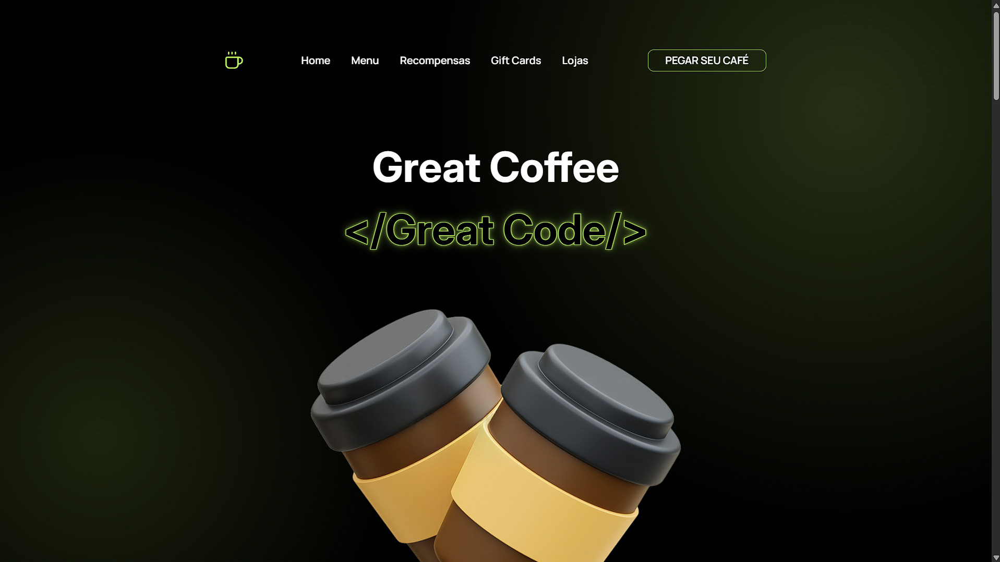

# Great Coffee — Landing Page


Landing page promocional do tipo *One-Page* desenvolvida com HTML5 semântico e CSS3 moderno. O projeto simula a presença digital de uma rede de cafeterias e hubs de trabalho voltada para desenvolvedores de software, construída como entregável técnico para a capacitação de Front-End da **CP2eJr**.




---

## Arquitetura e Decisões Técnicas

O projeto foi construído sem dependência de frameworks ou bibliotecas externas de estilização, priorizando o domínio das especificações nativas da web:

* **Modern CSS Reset:** Substituição do antigo `normalize.css` por um reset direto focado em `box-sizing: border-box`, remoção de margens nativas do User Agent e padronização de herança tipográfica em elementos de formulário.
* **Design Tokens com CSS Variables (`:root`):** Centralização da paleta de cores (`#BEF264`, `#000000`, `#FFFFFF`) e famílias tipográficas (`Inter` e `Manrope`) para garantir consistência visual e manutenção escalável.
* **Composição de Layouts por Seção:**
  * **Hero Section (`100vh`):** Controle de fluxo vertical com Flexbox, iluminação de fundo via múltiplos `radial-gradient` no CSS e tipografia vazada utilizando `-webkit-text-stroke` combinado com `paint-order: stroke fill`.
  * **Seção Menu (CSS Grid e Scroll Snap):** Grade fluida responsiva no Desktop (`repeat(auto-fit, minmax(250px, 1fr))`) que se converte em um carrossel horizontal nativo no Mobile utilizando `scroll-snap-type: x mandatory`.
  * **Seção Recompensas (Timeline):** Linha do tempo vertical construída com posicionamento relativo/absoluto e pseudo-elementos (`::after`), simulando um histórico de commits do Git.
  * **Seção Gift Cards (Split Screen 50/50):** Layout simétrico baseado em `flex-basis: 50%` com hierarquia de chamadas para ação (CTAs) e animação contínua via `@keyframes`.
  * **Seção Lojas (Bento Grid):** Grade assimétrica utilizando `grid-row: span 2` para destacar a unidade principal (*Flagship Store*), uso da tag semântica `<address>` e recorte proporcional de imagens com `object-fit: cover`.

---

## Estrutura de Diretórios

```text
capacitacao-html-css/
├── CSS/
│   ├── reset.css       # Reset moderno para padronização entre navegadores
│   └── style.css       # Estilização global, componentes, animações e Media Queries
├── img/
│   ├── Vector.svg      # Logotipo em vetor
│   ├── coffee.png      # Ilustração principal da seção Hero
│   └── ...             # Recursos visuais dos cartões e unidades
├── index.html          # Estrutura principal semântica
└── README.md           # Documentação técnica do repositório
```

---

## Responsividade (Desktop e Mobile)

A adaptação para telas menores (breakpoint em `768px`) reestrutura os componentes para preservar a legibilidade e a usabilidade em dispositivos móveis:

| Componente | Comportamento Desktop (`> 768px`) | Comportamento Mobile (`<= 768px`) |
| :--- | :--- | :--- |
| **Header / Navegação** | Links horizontais centralizados e botão de ação | Menu oculto com ícone de duas barras desenhado via CSS (`::after`) |
| **Hero Section** | Título principal e ilustração ancorada na base | Adição de texto descritivo introdutório e botão centralizado |
| **Menu de Produtos** | Grade multi-colunas automática | Carrossel horizontal com trava de rolagem (*CSS Scroll Snap*) |
| **Log de Recompensas** | Eixo centralizado alternando cartões (Esquerda/Direita) | Eixo deslocado para a margem esquerda com leitura em coluna única |
| **Bento Grid (Lojas)** | Layout assimétrico em duas colunas (`1.3fr 1fr`) | Colapso para coluna simples (`1fr`) e ajuste de espaçamento interno |

---

## Como Executar Localmente

Por utilizar exclusivamente tecnologias nativas interpretadas pelo navegador, não é necessário instalar dependências via gerenciadores de pacotes:

1. Clone este repositório:
   ```bash
   git clone [https://github.com/SEU-USUARIO/NOME-DO-REPOSITORIO.git](https://github.com/SEU-USUARIO/NOME-DO-REPOSITORIO.git)
   ```

2. Acesse o diretório do projeto:
   ```bash
   cd NOME-DO-REPOSITORIO
   ```

3. Abra o arquivo `index.html` diretamente em qualquer navegador moderno ou utilize a extensão **Live Server** no VS Code para visualizar o projeto em servidor local.

---

## Autor

**Otávio Augusto Faria Silveira**  
Estudante de Engenharia de Software — Inatel.                                                                             
Membro da CP2eJr - Acessor do Núcleo de Projetos.

* [GitHub](https://github.com/otavioFaria0)
* [LinkedIn](https://www.linkedin.com/in/otavio-augusto-faria-silveira/)